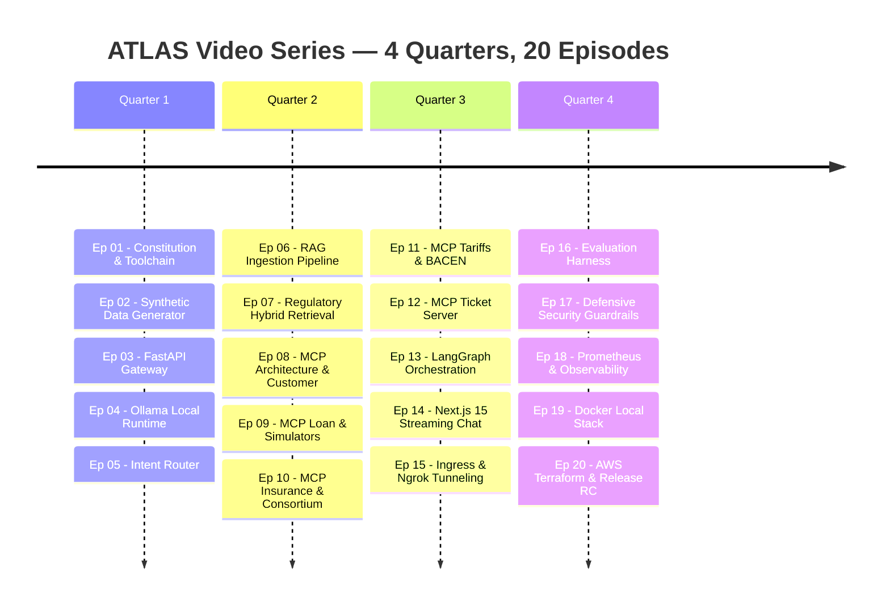

# ATLAS Banking Copilot — Video Series Curriculum (20 Episodes)

> **Format:** 10–18 min technical deep-dives (screencast + system architecture breakdown + live coding).  
> **Platforms:** YouTube Tech Channel & LinkedIn Tech Carousels / Video Snippets.  
> **Target Audience:** Senior Software Engineers, AI/ML Engineers, Solutions Architects, Tech Leads.

---

## 📅 Curriculum Roadmap Overview

---

## 🎬 Episode Syllabus Breakdown

### Quarter 1: Foundations & Core Architecture
* **Ep 01 — Engenharia de Software para GenAI: A Constituição do ATLAS**
  * *Tópicos:* Princípios inegociáveis (Local-First, Security by Default, Evidência antes de claims), Toolchain Python moderno com `uv`, monorepo e governança com SDDs.
* **Ep 02 — Gerador de Dados Sintéticos e LGPD: Criando o Core Bancário Local**
  * *Tópicos:* Geração determinística de clientes, contas e transações bancárias sintéticas com Faker e Pydantic; isolamento de PII.
* **Ep 03 — Construindo o Gateway ASGI de Alta Performance com FastAPI**
  * *Tópicos:* Arquitetura assíncrona, injeção de correlation ID, middlewares de observabilidade e OpenAPI Swagger automático.
* **Ep 04 — LLMs Open-Weights Locais com Ollama e Qwen 2.5 7B**
  * *Tópicos:* Por que rodar localmente? Configuração de runtime, chamadas estruturadas JSON, streaming e mocks determinísticos para testes.
* **Ep 05 — Roteamento Semântico de Intenções: Separando RAG de Ações**
  * *Tópicos:* Classificação de intenções (Knowledge, Simulation, Action, Clarification), extração de entidades e testes com dataset dourado.

### Quarter 2: RAG Regulatório & Model Context Protocol (MCP)
* **Ep 06 — Ingestão RAG de Normativas do Banco Central (BACEN)**
  * *Tópicos:* Chunking hierárquico com preservação de artigos e incisos legais, embeddings locais com `nomic-embed-text` e ChromaDB.
* **Ep 07 — Recuperação Híbrida e Citação Legal Obrigatória**
  * *Tópicos:* Busca vetorial com metadados estritos, cálculo de similaridade cosseno e formatação de badges de citação jurídica.
* **Ep 08 — O que é MCP (Model Context Protocol)? O Servidor de Clientes**
  * *Tópicos:* A revolução do MCP da Anthropic; desacoplando ferramentas de LLMs; implementação do MCP Customer Server.
* **Ep 09 — Simuladores Financeiros Determinísticos: Empréstimos (Price vs SAC)**
  * *Tópicos:* Por que LLMs não devem fazer contas matemáticas; Tabela Price e SAC determinísticas em Python via ferramentas MCP.
* **Ep 10 — Consórcios e Seguros: Módulos Financeiros Avançados**
  * *Tópicos:* Regras de negócios para seguros residencial/auto/vida e lances de consórcio integrados via MCP.

### Quarter 3: Governança, Orquestração e Experiência do Usuário
* **Ep 11 — Comparador de Tarifas Bancárias (Resolução CMN 3.919)**
  * *Tópicos:* Integração do catálogo de tarifas essenciais versus pacotes pagos com auditoria de conformidade regulatória.
* **Ep 12 — Human-in-the-Loop (HITL) na Prática: Servidor de Tickets**
  * *Tópicos:* Padrão de aprovação em dois turnos com tokens temporários criptográficos; prevenção contra mutações acidentais.
* **Ep 13 — Orquestração de Agentes com LangGraph StateGraph**
  * *Tópicos:* Máquina de estados cíclica, controle de fluxo determinístico, checkpoints de sessão e transição entre RAG e ferramentas.
* **Ep 14 — Frontend Reativo com Next.js 15, React 19 e Streaming SSE**
  * *Tópicos:* Consumo de Server-Sent Events em tempo real, renderização de cards interativos de simulação e interface bancária moderna.
* **Ep 15 — Ingress Híbrido: Conectando a Vercel Cloud ao Backend Local com Ngrok**
  * *Tópicos:* Como expor APIs locais de IA para o mundo com domínio estático, CORS rigoroso e testes de smoke automáticos.

### Quarter 4: Qualidade, Segurança, Observabilidade & Nuvem
* **Ep 16 — Evaluation Harness: Como Medir e Testar Aplicações GenAI**
  * *Tópicos:* Métricas de RAG (Context Recall, Groundedness, MRR), teste de acurácia de intenções e Quality Gates automáticos no CI/CD.
* **Ep 17 — Defesa Cibernética para LLMs: Guardrails Contra Prompt Injection**
  * *Tópicos:* Proteção em duas camadas (Input Guardrail regex/semântico e Output PII masking com regex brasileiro de CPF/contas).
* **Ep 18 — Observabilidade Enterprise: Métricas Prometheus e Tracing Distribuído**
  * *Tópicos:* Contabilidade precisa de tokens e cálculo de custo em USD por sessão, dashboards Grafana e middleware de telemetria.
* **Ep 19 — Containerização e Stack Local Completo com Docker Compose**
  * *Tópicos:* Dockerfile multi-stage com usuário não-root, composição de rede bridge isolada e orquestração de todos os serviços.
* **Ep 20 — Da Máquina Local à AWS: Infraestrutura como Código com Terraform**
  * *Tópicos:* Módulos ECS Fargate, ALB, OpenSearch Serverless, S3, Secrets Manager, estimativa de custos e o lançamento da Release v1.0.0.
