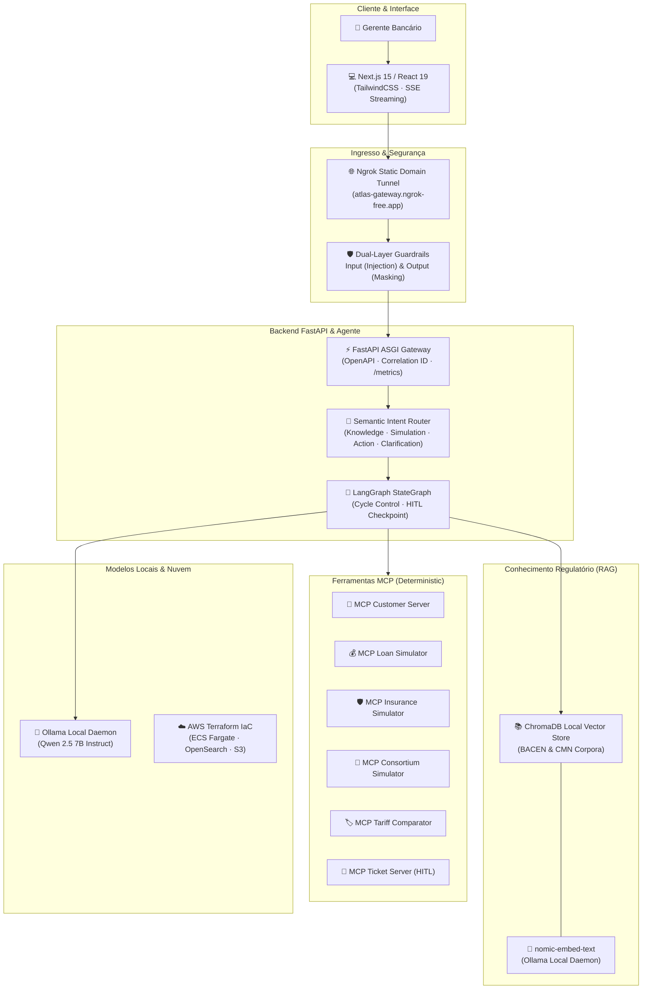

# ATLAS — Banking GenAI Copilot

[](file:///c:/Users/rogall/source/repos/atlas/CHANGELOG.md)
[](file:///c:/Users/rogall/source/repos/atlas/4.tests)
[](file:///c:/Users/rogall/source/repos/atlas/CHANGELOG.md)
[](file:///c:/Users/rogall/source/repos/atlas/7.evals/reports/final_scorecard_v1.0.0.md)
[](https://www.python.org/)
[](https://docs.astral.sh/uv/)
[](https://www.langchain.com/langgraph)
[](https://modelcontextprotocol.io/)
[](file:///c:/Users/rogall/source/repos/atlas/infra/terraform)

**ATLAS** (*Agentic Tiered Lightweight Advisory System*) é um copiloto conversacional bancário corporativo de alta precisão para gerentes de relacionamento. Ele consulta normativas regulatórias do **Banco Central do Brasil (BACEN)** com citação jurídica obrigatória via RAG, inspeciona perfis e transações bancárias sintéticas e executa simulações financeiras determinísticas via **Model Context Protocol (MCP)** com governança **Human-in-the-Loop (HITL)**.

---

## 🏛️ Princípios & Governança (Constituição)

O projeto segue à risca os princípios inegociáveis formalizados em:
- [Constituição do Projeto (`constitution.md`)](file:///c:/Users/rogall/source/repos/atlas/constitution.md) — Local-first, segurança por padrão, ferramentas explícitas, evidência antes de claims e 100% dados sintéticos.
- [Arquitetura do Sistema (`architecture.md`)](file:///c:/Users/rogall/source/repos/atlas/architecture.md) — As 6 fronteiras do sistema (Frontend, API Gateway, Agent Router, MCP, RAG, Infraestrutura).
- [Architecture Decision Records (`8.docs/adr/`)](file:///c:/Users/rogall/source/repos/atlas/8.docs/adr/README.md) — Catálogo de 12 decisões técnicas fundamentadas (ADR-0001 a ADR-0012).
- [Histórico de Entregas (`CHANGELOG.md`)](file:///c:/Users/rogall/source/repos/atlas/CHANGELOG.md) — Entregas incrementais dos 4 trimestres (S00 a S22).

---

## 📐 Arquitetura do Sistema



---

## ⚡ Quickstart em 5 Minutos

### Pré-requisitos
- **Python 3.11+**
- **uv** instalado (`curl -LsSf https://astral.sh/uv/install.sh | sh` ou via `irm https://astral.sh/uv/install.ps1 | iex`)
- **Node.js 20+**
- **Ollama** executando localmente (`ollama serve` com os modelos `qwen2.5:7b-instruct` e `nomic-embed-text`)

### 1. Clonar e Sincronizar Dependências
```bash
git clone https://github.com/rogallan/atlas.git
cd atlas
uv sync --all-extras
```

### 2. Iniciar o Backend FastAPI Gateway
```bash
uv run uvicorn api.main:app --port 8000 --reload
```
- **Documentação Swagger:** http://localhost:8000/docs
- **Métricas Prometheus:** http://localhost:8000/metrics

### 3. Iniciar o Frontend Next.js
```bash
cd 3.frontend
npm install
npm run dev
```
- Aceda à interface em: http://localhost:3000

### 4. (Opcional) Ingress Público via Ngrok
```bash
# Em outro terminal na raiz
uv run python scripts/start_tunnel.py
```

---

## 🧪 Qualidade, Testes e Avaliações

O ATLAS possui uma pirâmide de testes completa com **299 testes automatizados** e **84.6% de cobertura de código**:

```bash
# Executar a suíte completa de testes unitários e de integração
uv run pytest

# Verificações estáticas de estilo e tipagem
uv run ruff check .
uv run mypy

# Executar a auditoria oficial de DoD (Definition of Done)
uv run python 6.ops/release/release_checklist.py

# Executar a auditoria de segurança (zero segredos e dados sintéticos)
uv run python 6.ops/release/security_audit.py

# Executar o benchmark executivo de avaliação GenAI
uv run python -m evals.runner --report-path 7.evals/reports/final_scorecard_v1.0.0.md
```

---

## 🌟 Portfólio & Demonstração Técnica

- 🎬 [Roteiro de Demonstração Interativa (`demo_script.md`)](file:///c:/Users/rogall/source/repos/atlas/8.docs/portfolio/demo_script.md) — Roteiro de 10 minutos cobrindo RAG com citações, MCP, simulações financeiras determinísticas, aprovação HITL e defesa contra injeção de prompt.
- 📹 [Currículo da Série de 20 Vídeos (`video_curriculum.md`)](file:///c:/Users/rogall/source/repos/atlas/8.docs/portfolio/video_curriculum.md) — Grade dos 20 episódios técnicos divididos ao longo dos 4 trimestres do PDI.
- 📊 [Scorecard de Avaliação Executiva v1.0.0](file:///c:/Users/rogall/source/repos/atlas/7.evals/reports/final_scorecard_v1.0.0.md) — Relatório de benchmark com 96% de acurácia de intenção e 100% de conformidade com os guardrails de segurança.
- ☁️ [Estimativa e Modelo de Custos AWS](file:///c:/Users/rogall/source/repos/atlas/docs/architecture/aws_cost_estimate.md) — Modelo de custos de infraestrutura comparando Dev ($222/mês) vs. Produção ($444/mês).
- 📂 [Resumo do Portfólio Técnico](file:///c:/Users/rogall/source/repos/atlas/8.docs/portfolio/README.md) — Visão executiva da engenharia e arquitetura do ATLAS.
