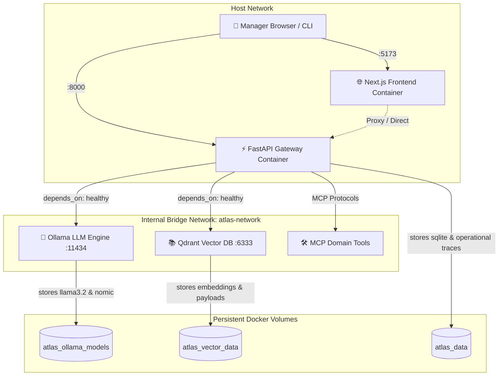

# Runbook — S20 · Docker Local Stack

> **Domain:** Platform & DevOps · **Target:** Local Multi-Service Container Orchestration · **Status:** Production-Ready

---

## 1. Overview & Architecture

The ATLAS Banking Copilot Docker Local Stack provides a reproducible, containerized local environment orchestrated via Docker Compose. It satisfies the **Local-First** architectural mandate (Principle 1 of `constitution.md`), enabling full offline execution without third-party cloud dependencies.

### Container Topology & Network Architecture



---

## 2. Prerequisites

| Component | Minimum Version | Recommended | Notes |
| :--- | :--- | :--- | :--- |
| **Docker Engine** | 24.0+ | 27.0+ | Docker Desktop on macOS/Windows, Docker Engine on Linux |
| **Docker Compose** | v2.20+ | v2.29+ | `docker compose` CLI plugin |
| **System Memory** | 8 GB RAM | 16 GB RAM | Required for local LLM inference (`llama3.2:3b`) |
| **Free Disk Space** | 10 GB | 20 GB | For container images and downloaded model weights |

---

## 3. Quickstart: Running the Stack

### 3.1 Core Backend Stack (Default)
Starts the FastAPI Gateway, Ollama LLM Engine, Qdrant Vector DB, and model initialization hook:

```bash
# From repository root
docker compose up -d
```

### 3.2 Full Stack with Local Web Frontend
Starts the core services plus the containerized Next.js frontend (offline development mode):

```bash
docker compose --profile frontend-local up -d
```

### 3.3 Core Stack with Public HTTPS Tunnel (ngrok)
Starts the core services plus the containerized ngrok tunnel exposing the Gateway to external clients (e.g. Vercel deployment, mobile app, webhook callbacks):

```bash
docker compose --profile ngrok up -d
```

### 3.4 Everything (Full Local Stack + ngrok)
Starts Gateway, Ollama, Vector DB, local frontend, and public ngrok tunnel simultaneously:

```bash
docker compose --profile full up -d
```

---

## 4. Services & Port Mapping

| Service Name | Container Name | Host Port | Internal Port | Health Check Endpoint |
| :--- | :--- | :--- | :--- | :--- |
| **Gateway** | `atlas-gateway` | `8000` | `8000` | `GET http://localhost:8000/health` |
| **Ollama** | `atlas-ollama` | `11434` | `11434` | `CLI: ollama list` |
| **Vector DB** | `atlas-vector-db`| `6333` | `6333` | `GET http://localhost:6333/healthz` |
| **Frontend** | `atlas-frontend` | `5173` | `3000` | `GET http://localhost:5173/` |
| **ngrok Tunnel**| `atlas-ngrok` | `4040` | `4040` | `GET http://localhost:4040/` (Web UI Inspector) |
| **Init Ollama**| `atlas-init-ollama`| *None* | *None* | Runs model pre-pull once upon boot |

---

## 5. Model Management & Automated Caching

The stack includes an automated model initialization hook (`init-ollama` container executing `infra/docker/init_ollama.sh`) that triggers after the Ollama engine reports healthy.

### Default Models:
- **LLM Reasoning & Chat:** `llama3.2:3b` (~2.0 GB)
- **Dense Embeddings:** `nomic-embed-text` (~274 MB)

Models are saved to the persistent volume `atlas_ollama_models`. Once downloaded, subsequent container starts do not re-download weights.

To inspect downloaded models:
```bash
docker exec -it atlas-ollama ollama list
```

---

## 6. Persistence & Volume Management

The stack defines three named volumes that isolate and preserve state:

1. **`atlas_ollama_models`:** Stores downloaded GGUF weights in `/root/.ollama`.
2. **`atlas_vector_data`:** Stores Qdrant vector index segments in `/qdrant/storage`.
3. **`atlas_data`:** Stores Gateway operational traces, SQLite databases, and synthetic seeds in `/app/data`.

### Verifying Persistence Across Teardowns:
```bash
# 1. Stop containers (preserves volumes)
docker compose down

# 2. Restart stack
docker compose up -d

# 3. Verify models and collections are intact
docker exec -it atlas-ollama ollama list
curl -s http://localhost:6333/collections
```

---

## 7. NVIDIA GPU Acceleration (Optional)

On hosts with NVIDIA GPUs and the NVIDIA Container Toolkit installed, GPU acceleration can be enabled without modifying the base compose file:

1. Copy the override example:
   ```bash
   cp infra/docker/docker-compose.override.yml.example docker-compose.override.yml
   ```
2. Recreate the Ollama container:
   ```bash
   docker compose up -d ollama
   ```
3. Verify GPU offloading:
   ```bash
   docker exec -it atlas-ollama nvidia-smi
   ```

---

## 8. Automated Smoke Testing

A dedicated test suite script validates container health, API contract compliance, and cross-service latency:

```bash
# Run against live running Docker stack:
python scripts/smoke_test_docker.py

# Run in mock/dry-run mode (e.g. CI environments without Docker-in-Docker):
python scripts/smoke_test_docker.py --dry-run
```

---

## 9. Security & Container Hardening

In accordance with banking grade enterprise standards:
- **Non-Root Execution:** The backend container (`Dockerfile.backend`) executes strictly as `appuser:appuser` (UID/GID 1000). The frontend container executes as `nextjs:nodejs` (UID/GID 1001).
- **Network Isolation:** All inter-service traffic flows over the isolated user-defined Docker bridge `atlas-network`. Only external ingress ports (`8000`, `5173`) are published to the host.
- **Layer Optimization:** Build tools (`gcc`, package managers) are isolated in the `builder` stage and omitted from runtime images.

---

## 10. Operational Troubleshooting

### Problem: Port 8000 or 11434 already in use
**Solution:** Specify alternative ports in your `.env` file:
```bash
GATEWAY_PORT=8080
OLLAMA_PORT=11435
docker compose up -d
```

### Problem: Ollama downloads fail or time out
**Solution:** Manually pull models inside the container:
```bash
docker exec -it atlas-ollama ollama pull llama3.2:3b
docker exec -it atlas-ollama ollama pull nomic-embed-text
```

### Problem: Complete Environment Purge / Hard Reset
To delete all containers, networks, and persistent volume data:
```bash
# WARNING: Deletes all downloaded models and stored vector indices
docker compose down -v
```
