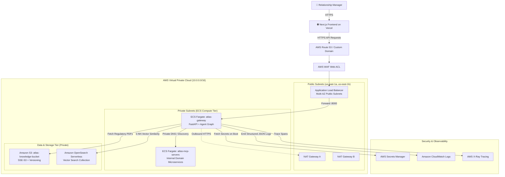

# Architectural Equivalence Matrix: Local-First $\leftrightarrow$ AWS Cloud (S21)

> **Domain:** Platform & Cloud Architecture · **Version:** 1.0.0 · **Status:** Production-Ready

---

## 1. Context & Architectural Philosophy

Per `architecture.md` and `constitution.md` (**Principle 1: Local-First Development**), the ATLAS Banking Copilot is engineered so that developers can build, run, test, and evaluate 100% of functionality locally without cloud vendor lock-in.

However, enterprise banking adoption requires an explicit, production-grade cloud deployment pathway. This document defines the **Architectural Equivalence Matrix**, mapping every containerized local component (S01–S20) to its corresponding managed AWS cloud infrastructure component (S21) provisioned declaratively via Terraform.

---

## 2. Component Equivalence Matrix

| # | Local Subsystem (S00–S20) | AWS Cloud Equivalent (S21) | AWS Service Description | Security & Reliability Rationale |
| :-: | :--- | :--- | :--- | :--- |
| **1** | **FastAPI Gateway (Docker)** | **Amazon ECS Fargate + ALB** | Containerized serverless task running FastAPI, Agent Graph, and API routing behind Application Load Balancer. | Multi-AZ auto-scaling without VM management; TLS termination at ALB; private subnet isolation. |
| **2** | **MCP Domain Services** | **ECS Fargate (Internal Service / Sidecar)** | Containerized microservices (Customer, Loan, Insurance, Consortium, Tariff, Ticket). | No public exposure; accessible exclusively via VPC private network and Service Discovery (`aws_service_discovery_service`). |
| **3** | **Vector Store (Chroma / Qdrant)** | **Amazon OpenSearch Serverless (Vector Search)** | Managed vector search collection with k-NN index. | Zero-server capacity management, automated replication across AZs, enterprise encryption at rest. |
| **4** | **Regulatory PDFs (`data/docs`)** | **Amazon S3 (`atlas-knowledge-bucket`)** | High-durability object storage with AES-256 encryption and versioning. | Strict bucket policy, SSE-S3/KMS, lifecycle rules to transition old normative circulars to Glacier. |
| **5** | **Local Secrets (`.env`)** | **AWS Secrets Manager + KMS** | Cryptographically protected credential vault. | Rotatable API keys, fine-grained IAM task role access, no secrets stored in container images. |
| **6** | **Tracing & Logs (OTel/structlog)** | **CloudWatch Logs + AWS X-Ray** | CloudWatch log group with 30-day retention and X-Ray distributed trace daemon. | Automated log aggregation, audit trail compliance (BACEN Res. 4.893), latency waterfall visualization. |
| **7** | **Security Guardrails (S18)** | **AWS WAF + Container Middleware** | WAF Web ACL protecting ALB; PII sanitizers running in ECS task. | Defense-in-depth: network-level rate limiting, injection shielding (WAF) + semantic validation (Agent). |
| **8** | **React Frontend (Next.js)** | **Vercel Production Deployment** | Edge-rendered Next.js frontend connecting to AWS ALB domain. | Frontend remains on Vercel per architecture; connects to ALB via HTTPS with CORS controls. |

---

## 3. Cloud Topology & Data Flow

---

## 4. Network Isolation & Security Boundaries

1. **Zero Public Container IPs:** All ECS tasks run inside private subnets (`10.0.10.0/24`, `10.0.11.0/24`) without public IPv4 assignments (`assign_public_ip = false`).
2. **Ingress Control:** Inbound traffic to the ECS Gateway is restricted exclusively to the Application Load Balancer Security Group on port 8000.
3. **Egress Control:** Egress from private subnets for external API access (e.g. LLM APIs or package updates) is mediated strictly through redundant NAT Gateways.
4. **Least-Privilege IAM Separation:**
   - **Task Execution Role:** Permits ECS agent to pull container images from Amazon ECR and write boot logs to CloudWatch.
   - **Task Role:** Permits the running application code to read from the knowledge S3 bucket, query the OpenSearch Serverless endpoint, and fetch designated secret keys.
